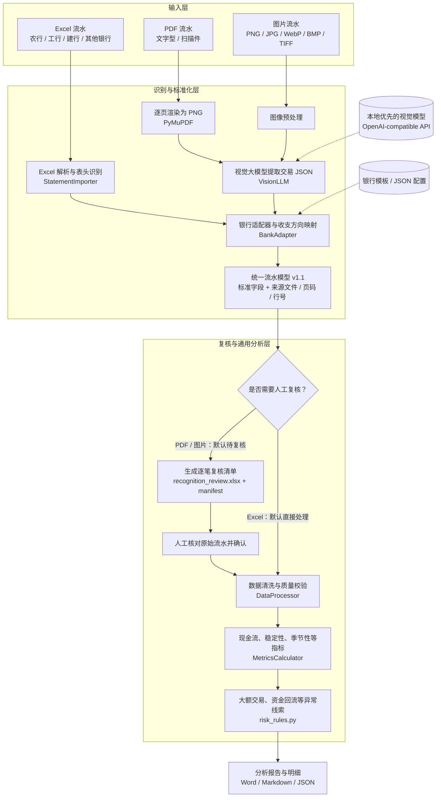

# 银行信贷流水审核辅助分析

基于 [weiwill88/bank-statement-analysis](https://github.com/weiwill88/bank-statement-analysis) 的职责分层思路实现多银行格式接入、统一流水清洗、现金流分析、异常识别及报告生成。本仓库使用独立实现代码，未直接复制原仓库源码。

## 架构

下面的系统架构图对应当前已实现的处理链路，展示不同格式流水如何统一进入分析引擎：

说明：**所有 PDF 均先逐页渲染，再由视觉大模型识别**，不会因 PDF 含文字层或表格线而绕过模型；图片同样走视觉识别。PDF / 图片识别结果默认需要人工复核，确认后才进入正式分析；`--allow-unreviewed` 仅供开发时生成带提示的草稿。当前未实现模板自学习和外部交叉验证。

* vision_llm.py / document_ingest.py：本地优先的视觉 LLM、PDF 逐页图像渲染及识别、来源页码和结构评分
* review_workflow.py：识别逐笔复核工作簿、复核状态和来源行完整性校验
* bank_adapters.py：BankAdapter 抽象基类、ABC / ICBC / CCB 初始模板、GENERIC 适配器、自定义 JSON 模板、多个 Excel 工作表导入
* statement_schema.py：STANDARD_COLUMNS，所有适配器必须满足的标准流水字段约定
* data_processor.py：仅消费标准列、去歧义、账号/币种隔离、缺失和重复标记、可验证的余额连续性
* metrics_calculator.py：收支趋势、候选经营性流水、偿债支出、日均余额、对手方、季节性
* risk_rules.py：大额、整数金额、回流、集中度、波动、重复记录等待复核线索
* report_generator.py：证据明细 JSON、DOCX 与 Markdown 报告

银行模板仅是常见 Excel 字段映射示例，不代表已兼容某银行所有网银版本，实际接入需脱敏样本验收。

## 安装和使用

~~~bash
pip install -r requirements.txt

# 自动根据文件名、文件前导信息识别银行；表头用通用别名解析
python main.py abc.xlsx --company "测试企业" --output output

# 同一客户不同银行/账户流水合并分析
python main.py abc.xlsx icbc.xlsx --company "测试企业" --output output

# 显式使用特定适配器
python main.py any.xlsx --bank ICBC --company "测试企业"

# 新银行无需更改分析代码，通过 JSON 定义字段映射
python main.py other.xlsx --bank CUSTOM --profile config/example_bank.json --company "测试企业"
~~~

输出 analysis.docx、analysis.md、analysis.json。JSON 中包含源文件、工作表、原始 Excel 行号和命中的规则编号，方便人工复核。

## PDF、图片与 LLM 识别

所有 PDF（文字型、带表格线、扫描件）**统一由视觉大模型逐页识别**，PyMuPDF 仅用于将 PDF 每页渲染成图片，不再使用文本表格直接提取。PNG/JPG 等图片也走相同的视觉识别接口。模型需支持 OpenAI-compatible 的 image_url 多模态请求。

~~~bash
# 所有 PDF 均要求视觉模型，含文字层 PDF 也一样
python main.py company.pdf --company "样例企业" --output output \
  --llm-url http://127.0.0.1:11434/v1/chat/completions \
  --llm-model your-local-vision-model

# 本机部署的视觉模型（仅示例，请使用实际可用的模型 ID）
python main.py scan.pdf photo.png --company "样例企业" --output output \
  --llm-url http://127.0.0.1:11434/v1/chat/completions \
  --llm-model your-local-vision-model

# 默认输出 output/recognition_review.xlsx + recognition_manifest.json
# 在“标准流水复核”工作表逐笔修正，审核状态全部改为“已确认”
python main.py --reviewed-xlsx output/recognition_review.xlsx \
  --company "样例企业" --output output

# 仅用于开发测试：未经复核生成标记为“草稿”的报告
python main.py photo.png --company "样例企业" --allow-unreviewed \
  --llm-url http://127.0.0.1:11434/v1/chat/completions \
  --llm-model your-local-vision-model
~~~

本地模型默认不需要 API Key；若模型服务需要认证，将令牌放入 BANK_LLM_API_KEY 环境变量。远程模型需要 --allow-remote-llm 显式授权，且仅允许 HTTPS。**严禁将未授权的银行流水上传到外部模型。**

图片支持 PNG、JPG/JPEG、WebP、BMP、TIFF；PDF 按约 200 DPI 逐页渲染，默认每份 PDF/多页图片最多 200 页，单张图片最多 3000 万像素。LLM 提取的记录全部默认待复核，并保留 PDF 页码和文件来源；可修改原始金额、日期，但复核时不能删减原始识别行或改动证据定位字段。

详细见 [多模态识别说明](docs/multimodal_ingestion.md)。

## 标准流水接口

详见 [标准数据模型](docs/standard_model.md)。强制字段包括：银行编码、账号、交易日期、贷方发生额、借方发生额、余额、交易用途、source_file、source_sheet、source_row。金额单位为人民币元，贷方为入账、借方为出账；具体银行如果用单一金额列，必须提供已核实的收支方向映射或显式 signed 配置。

## 限制与边界

* 支持 Excel（xls/xlsx）、PDF 和图片。**PDF 全部由视觉模型逐页识别**，不因文本层或表格线绕过模型。模型输出可能漏行、错列、识别金额错误；须逐页核对原件，不保证文件真实性，不做外部交叉验证。
* 支持 ABC/ICBC/CCB 的常见字段示例和自定义模板，并未针对各行真实导出格式做端到端验收。
* 默认严格限制人民币 CNY，外币数据会停止分析，避免不同币种直接相加。
* 无法自动识别银行时使用 GENERIC 通用表头映射，但按源文件、工作表生成临时银行标识，不把来源不明的同号账户误认为同一账户。
* 同日多笔交易缺少明确时间顺序时，余额连续性只检查可以确认的交易对；缺失的核验记录在报告中。
* 经营性收支是摘要关键词得到的**候选金额**，需要人工核对真实经营活动。
* 风险规则表示疑点，不代表交易虚假；不做报表、税票、合同等外部交叉验证。
* 安全、审计、脱敏、权限与生产运维尚待完善。

## 测试

~~~bash
pip install -r requirements.txt pytest
pytest -q
~~~

注意：上游 README 虽注明 MIT，但其仓库当时没有独立 LICENSE 文件；复用上游代码前应进一步确认许可。
